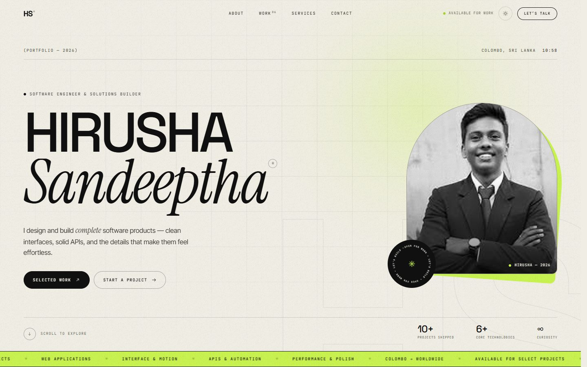
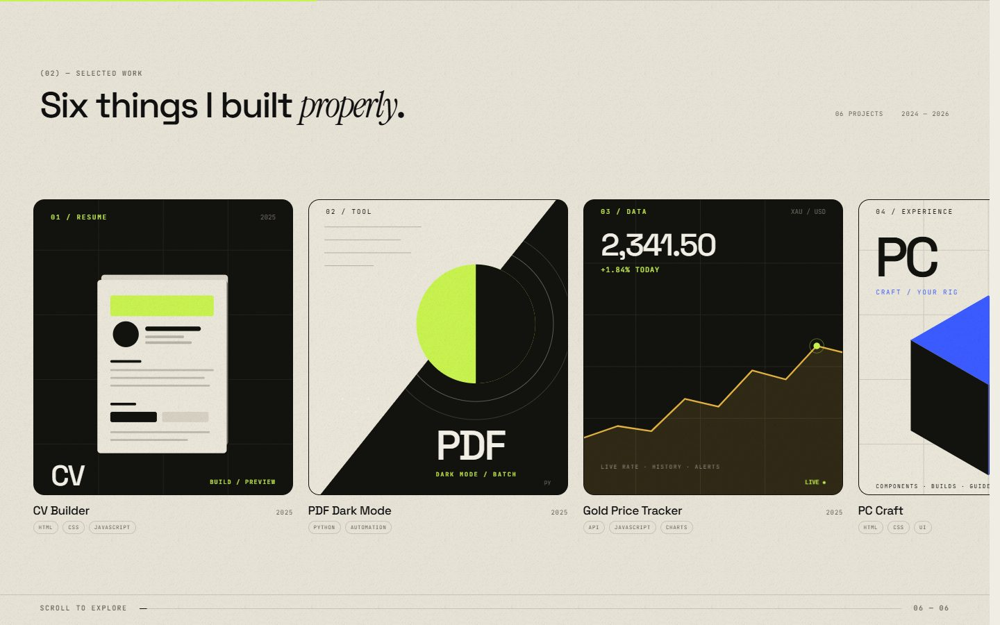
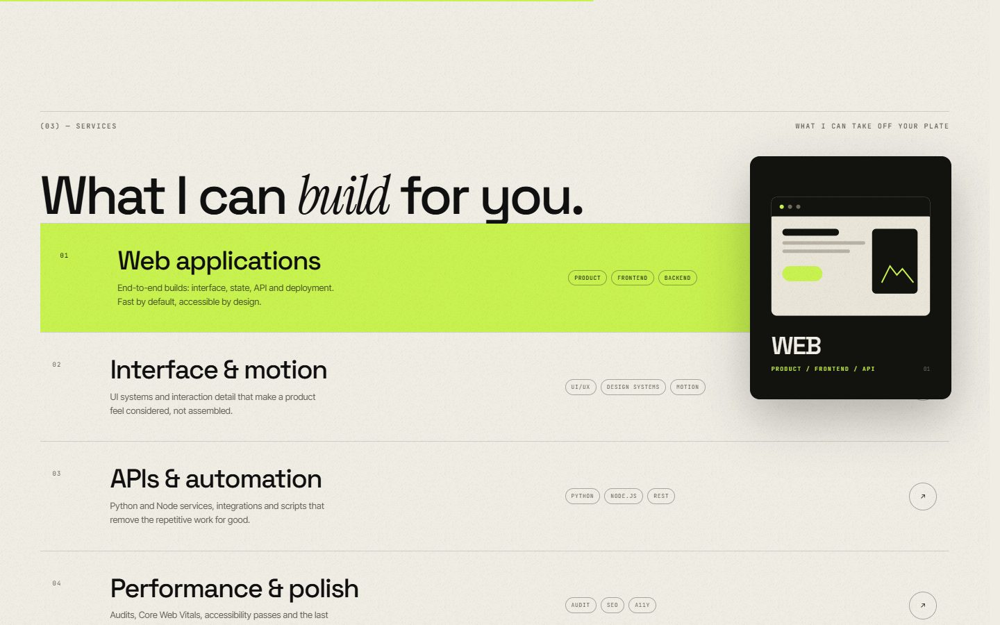
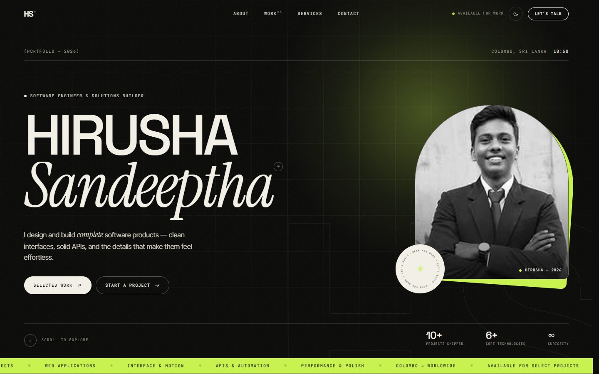
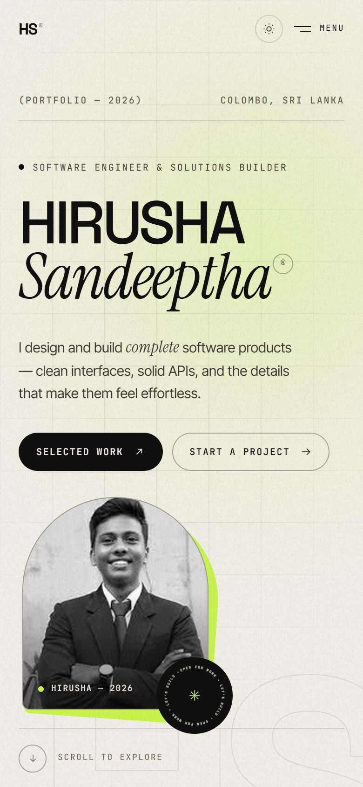

# Hirusha Sandeeptha — Portfolio 2026

A paper-and-ink portfolio for a software engineer who designs and ships complete products. Built from scratch — no page builder, no framework, no template.

**Live:** https://hirushasandeeptha.github.io/my-portfolio/



---

## The idea

Most developer portfolios look like developer portfolios: dark background, cyan glow, the same stack of cards. This one is meant to feel like a piece of editorial design instead — warm paper, near-black ink, one fluorescent signal colour, and typography that does most of the talking.

| | |
| --- | --- |
| **Paper** | `#F0EDE5` |
| **Ink** | `#101010` |
| **Signal** | `#C8F24F` |
| **Display** | Space Grotesk |
| **Accent** | Instrument Serif Italic |
| **Body** | Inter Tight |
| **Labels** | JetBrains Mono |

The light theme is the default; a dark "ink" theme is one click away. Both share the same chartreuse signal.

## What's inside

- **A proper entrance.** A counted preloader, then a choreographed hero: characters rise out of masked lines, the portrait reveals itself, and the ticker slides in.
- **A pinned horizontal work gallery.** On desktop, six project posters sit on a rail that moves sideways as you scroll; on mobile it becomes a native swipe rail. A progress line tracks the journey.
- **Case-study modals.** Every project opens a focused panel with the poster, role, stack, summary and three highlights — no page reloads, with focus trapping, `Esc` to close, and focus restored to the card.
- **A cursor with manners.** The dot and ring follow at different speeds and change state over links and cards ("View" / "Open"). It disappears entirely for touch users and reduced-motion users.
- **Words that light up.** The about statement is split into words and revealed on scroll.
- **Service previews.** Hovering a service wipes the row in signal green and brings up a small illustrated panel on the right.
- **Magnetic buttons** that lean toward the pointer.
- **Theme switch** with a native view transition (where supported) and a saved preference.
- **Live Colombo clock** in the header, menu and contact section.
- **Motion with judgement.** GSAP + ScrollTrigger for choreography, Lenis for smooth scrolling, and a full `prefers-reduced-motion` fallback.
- **Works without JavaScript** for the essentials: the preloader hides, the work rail becomes scrollable, and a compact nav appears on small screens.
- **Accessibility checked.** Author-level axe-core audit (WCAG 2.1 A/AA) returns zero violations on the landing page and project modal at 1440px.

### Work



### Services



### Dark theme



### Mobile



## Sections

1. **Hero** — name, role, portrait, live local time, selected work / start a project, availability ticker.
2. **About** — scroll-lit statement, honest intro, three counters, signature.
3. **Work** — six project posters, horizontal pin on desktop / swipe rail on mobile, case-study modals.
4. **Services** — four ways to work together, with illustrated hover previews.
5. **Principle** — a pause, a quote, and an oversized asterisk.
6. **Toolkit** — the short, honest list, plus an outlined type marquee.
7. **Contact** — a big lime invitation, direct email, GitHub / LinkedIn / email, local time, availability.
8. **Footer** — colophon and back-to-top.

## Stack

- Semantic HTML5 and hand-written CSS (custom properties, `clamp()`, grid, `svh`, view transitions).
- Vanilla JavaScript — no framework, no build step.
- [GSAP 3.12](https://gsap.com/) + [ScrollTrigger](https://gsap.com/docs/v3/Plugins/ScrollTrigger/) for scroll and timeline choreography.
- [Lenis 1.1](https://github.com/darkroomengineering/lenis) for smooth scrolling, driven by GSAP's ticker.
- Self-hosted variable fonts via [Fontsource](https://fontsource.org/): Space Grotesk, Inter Tight, Instrument Serif, JetBrains Mono.
- Inline SVG poster artwork — no stock photography, no external image requests.

Everything is vendored locally: the site works offline, and there is no CDN to go down.

## Structure

```
my-portfolio/
├── index.html                  # The portfolio
├── assets/
│   ├── css/
│   │   └── style.css           # Design system + all layout
│   ├── js/
│   │   ├── app.js              # Motion, cursor, gallery, menu, modal, theme
│   │   └── vendor/             # GSAP, ScrollTrigger, Lenis
│   ├── fonts/                  # Self-hosted woff2 files
│   ├── img/
│   │   ├── portrait.jpg        # Hero portrait
│   │   ├── grain.png           # Film grain overlay
│   │   └── showcase/           # README screenshots
│   └── favicon.svg
├── super-profile.html          # Earlier experiment (archive)
├── isometric-grid.html         # Earlier experiment (archive)
└── README.md
```

## Run it

Because the site uses local fonts and JavaScript files, serve it over HTTP rather than opening the file directly:

```bash
# from the project root
python -m http.server 8000
# then open http://localhost:8000
```

Any static server works — VS Code Live Server, `npx serve`, GitHub Pages, Netlify, etc.

## Customise it

| What | Where |
| --- | --- |
| Name, role, intro, stats | `index.html` → hero / about sections |
| Portrait | Replace `assets/img/portrait.jpg`, then adjust `object-position` in `.portrait-media img` |
| Project cards & poster art | `index.html` → `#work`; each poster is inline SVG |
| Project modal copy | `assets/js/app.js` → the `projects` object |
| Colours & spacing | `assets/css/style.css` → `:root` and `[data-theme="dark"]` |
| Fonts | `assets/fonts/` + the `@font-face` block at the top of the stylesheet |
| Email / social links | Search `hirushasandeeptha2006@gmail.com`, `github.com/hirushasandeeptha`, `linkedin.com` |
| Show/hide sections | Comment out the corresponding `<section>`; update the nav links |

### Notes on content

- The supplied portrait was **200 × 200 px**; it has been upscaled to 800 × 800 for display. Replace it with a higher-resolution portrait (ideally 1200 × 1500, portrait orientation) for a sharper result on retina screens.
- The LinkedIn URL in `index.html` is a best-guess profile path — please confirm or replace it with your real profile.
- Project descriptions are written from the projects in the previous portfolio. Adjust the `projects` object if any detail is out of date.
- `super-profile.html` and `isometric-grid.html` are kept as an archive of earlier experiments and are not linked from the new site.

## Performance

- No framework, no build step, no runtime CSS generation.
- Self-hosted fonts (5 woff2 files, ~150 KB total) and local libraries — no third-party requests.
- One photograph and one small grain texture; everywhere else is SVG and CSS.
- Animations are transform/opacity based; ScrollTrigger is measured once fonts settle.
- The page works with JavaScript disabled; only the enhancement layer is lost.

## Accessibility

- Skip link, landmarks, one `h1`, logical heading order.
- Visible `:focus-visible` outlines and keyboard-operable cards, menu and modal.
- Modal traps focus, closes on `Esc`, and restores focus to the trigger.
- Mobile menu marks the page inert while open.
- `prefers-reduced-motion` removes the preloader, parallax, pinning, cursor and marquees.
- Colour contrast audited with axe-core (WCAG 2.1 A/AA) — zero violations.
- Alt text on the portrait; decorative SVGs are `aria-hidden`.

## Credits

- Motion: [GSAP](https://gsap.com/) + [ScrollTrigger](https://gsap.com/docs/v3/Plugins/ScrollTrigger/), [Lenis](https://github.com/darkroomengineering/lenis).
- Type: Space Grotesk (Florian Karsten), Inter Tight (Rasmus Andersson), Instrument Serif (Instrument), JetBrains Mono (JetBrains) — all SIL Open Font License, served via [Fontsource](https://fontsource.org/).
- Design, code and words: Hirusha Sandeeptha.
- Portrait: supplied by Hirusha Sandeeptha.

---

© 2026 Hirusha Sandeeptha. Designed and built in Colombo.
